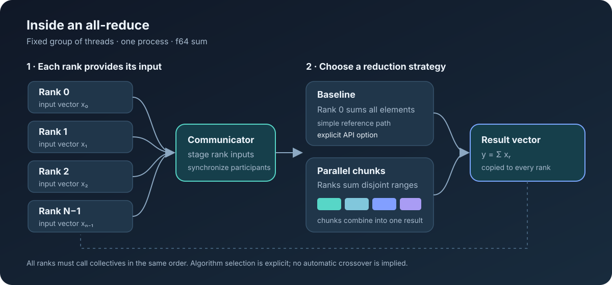
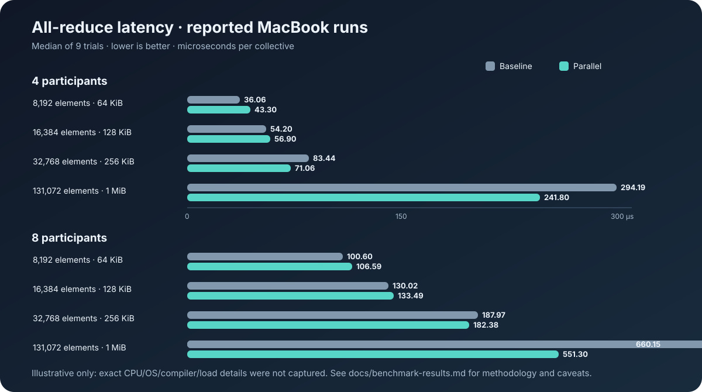

# cpu-collectives

A small, correctness-first CPU collective communication library. The initial prototype provides an in-process communicator for a fixed group of threads, a reusable barrier, and double-precision sum all-reduce.

This is experimental software, not a drop-in replacement for NCCL. No performance claims are made without reproducible benchmarks.

## Visual overview





The benchmark chart shows contributor-reported measurements for a specific machine and workload. See [benchmark methodology and caveats](docs/benchmarks.md) before drawing conclusions.

## Current scope

- C API with opaque communicator handles.
- Fixed-size, single-process thread groups.
- Reusable barrier and `cc_all_reduce_sum_f64`.
- Baseline rank-0 and parallel chunked reduction variants for benchmarking.
- C++20 implementation with no third-party dependencies.

Other collectives, additional datatypes, multi-process communication, and architecture-specific kernels are not implemented yet.

## Build and test

Requires CMake 3.20+ and a C++20-capable compiler.

```sh
cmake -S . -B build -DCMAKE_BUILD_TYPE=Release
cmake --build build --parallel
ctest --test-dir build --output-on-failure
```

## Benchmarks

All-reduce (participants, double elements, iterations, trials). This compares baseline and parallel variants in every trial:

```sh
./build/benchmarks/bench_all_reduce 4 4096 1000 5
```

Barrier (participants, iterations):

```sh
./build/benchmarks/bench_barrier 4 100000
```

See [docs/benchmarks.md](docs/benchmarks.md) for output interpretation and measurement guidance. See [docs/api.md](docs/api.md) for API contracts and [docs/architecture.md](docs/architecture.md) for design boundaries.
